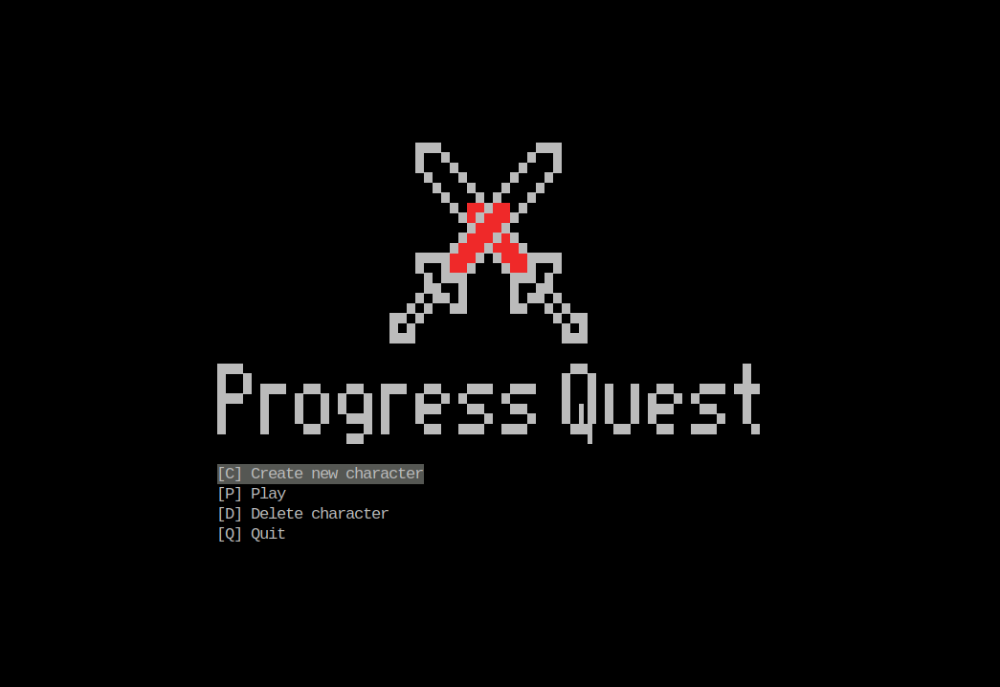
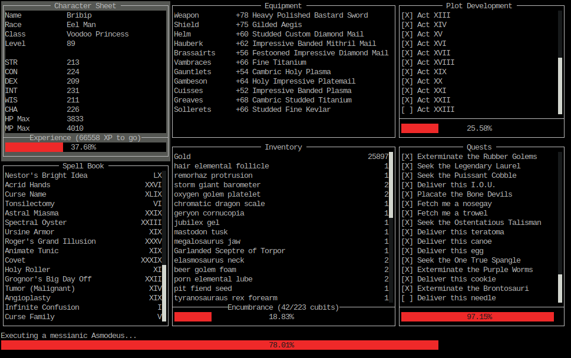
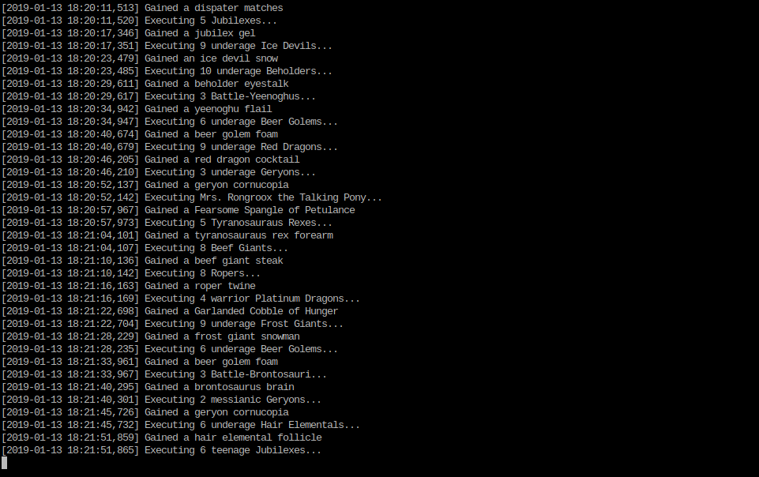

<p align="center">
  
</p>

Relive the great adventure… this time in the terminal realm!

- Progress Quest site:  http://progressquest.com/
- Online version:       http://progressquest.com/play/
- Original version:     https://bitbucket.org/grumdrig/pq

## Features

- Faithful port of the game logic
- Saves (with backups) to `$XDG_CONFIG_HOME/pqcli/save.dat`
- Terminal interface that comes in 2 flavors:
    - Rich and colorful (`--curses`, default)
    - Minimal, suitable for raw grind (`--basic`)
- Ideal to run on your server

## How it looks like

Curses interface:




Basic interface:



## How to install

If you have Python 3.10 or newer, just run `pip install --user pqcli` and you're good to go!
Then type `pqcli` to run the game.

In case if you want to use the git version, the process is just a bit more complex:

```console
$ git clone https://github.com/rr-/pq-cli.git
$ cd pq-cli
$ pip install --user .
```

## Docker / Docker Compose

The repository includes a `Dockerfile` and `docker-compose.yml` that run the
game with `--basic` and keep save data in a persistent named volume.

There is no registry pipeline required for this setup: build locally, then run
with Compose.

```console
# Build image locally from the Dockerfile
docker compose build

# First run (interactive): create your character in the shared save volume
docker compose run --rm pqcli-init

# Later runs on a server (detached, default save slot 1):
docker compose up -d pqcli

# List existing saves in the same volume:
docker compose run --rm pqcli-init pqcli --basic --list-saves

# Change detached slot if needed (example: slot 2):
PQCLI_SAVE_SLOT=2 docker compose up -d pqcli

# Follow logs / stop detached container:
docker compose logs -f pqcli
docker compose stop pqcli
```

On first run, if no save data exists in the mounted volume, `pqcli` will
automatically launch an interactive character-creation bootstrap in CLI mode
before starting the normal interface.

For server usage, run first-time setup without a forced slot (`pqcli-init`),
then run the long-lived detached service (`pqcli`) that loads slot `1` by
default.

## Customizing the adventure

All word lists (monsters, spells, equipment, races, classes, titles and so on)
live in JSON files. To change them, copy the built-in files somewhere and edit
them:

```console
$ pqcli --dump-data ~/.config/pqcli/data
```

On startup, pqcli reads `$XDG_CONFIG_HOME/pqcli/data/` (or the directory
given with `--data-dir DIR`). Each `NAME.json` there replaces the built-in
list of the same name. Files you leave out fall back to the built-in lists,
so you can delete the copies you don't change. If a file is malformed, pqcli
prints what is wrong and refuses to start.

The available files are `spells`, `offense_attrib`, `defense_attrib`,
`offense_bad`, `defense_bad`, `shields`, `armors`, `weapons`, `specials`,
`item_attrib`, `item_ofs`, `boring_items`, `monsters`, `races`, `classes`,
`titles`, `impressive_titles` and `combat_verbs`.

For example, to vary the combat descriptions, create `combat_verbs.json`.
`{target}` is replaced with the enemy:

```json
[
  "Executing {target}",
  "In a fierce battle to thwart {target}",
  "Fighting bravely against {target}",
  "Kicking the butt of {target}"
]
```

A few things to keep in mind:

- Order matters in `spells.json`: spells are learned roughly from the top
  down, so keep weaker spells first.
- Titles near the top of `titles.json` show up more often.
- Stats in `races.json` and `classes.json` are written as `STR`, `CON`,
  `DEX`, `INT`, `WIS`, `CHA`, `HP Max` or `MP Max`.
- Existing characters keep their race and class even if you remove them from
  the lists.

## Contributing

```sh
# Clone the repository:
git clone https://github.com/rr-/pq-cli.git
cd pq-cli

# Install to a local venv:
uv sync

# Install the git hooks (formatting, linting, commit messages):
uv run prek install

# Run the game and the tests:
just run
just test
```

This project uses [uv](https://docs.astral.sh/uv/) for packaging.
Install instructions are available at [uv#installation](https://docs.astral.sh/uv/getting-started/installation/).
The `justfile` needs [just](https://github.com/casey/just); without it, use
`uv run pqcli` and `uv run pytest`.

## Troubleshooting

### `_curses.error: init_pair() returned ERR`

If running on Linux and you get the error `_curses.error: init_pair() returned ERR`,
try making sure that your `$TERM` variable is set to a value which supports
256 colors, such as via the following:

    TERM=xterm-256color pqcli

